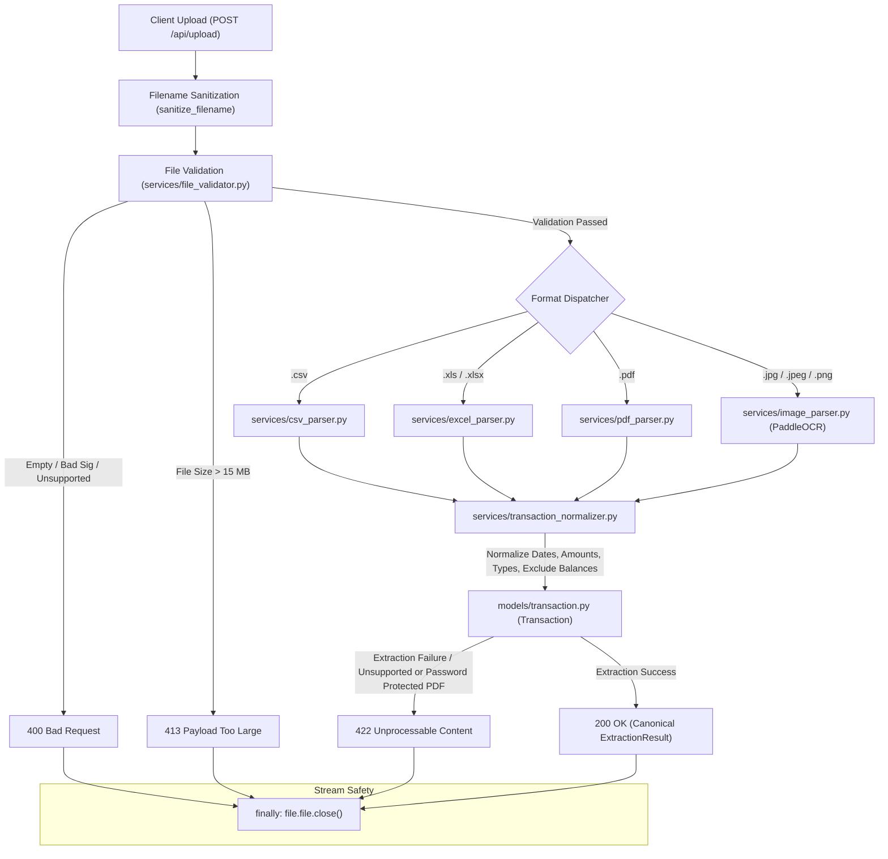

# Statement Upload & Data Extraction Module
**Responsible Team Member:** Tharanya  
**Repository:** [BillFold](https://github.com/Damsiiii/BillFold)  
**Branch:** `tharanya`

---

## 1. Module Overview & Purpose

The **Statement Upload & Data Extraction** module provides a secure, deterministic, and standardized ingestion pipeline for bank statement files in the **BillFold** personal finance management system.

The module allows users to upload raw bank statements in **PDF**, **CSV**, **Excel (.xls/.xlsx)**, **JPG/JPEG**, and **PNG** formats, validates their security and structural integrity, extracts financial transactions, normalizes dates, amounts, and descriptions, and returns standardized transaction records strictly conforming to the project's canonical eight-field transaction schema via a FastAPI REST endpoint (`POST /api/upload`).

---

## 2. Responsibilities & Strict Scope

### Within Scope
1. **File Upload & Validation**: Secure ingestion of PDF, CSV, XLS, XLSX, JPG/JPEG, and PNG statements, verifying MIME type when provided, signatures or image integrity, extensions, size constraints ($\le 15$ MB), and path traversal prevention.
2. **Format-Specific Extraction**:
   - **PDF**: Table extraction and fallback text-line parsing using `pdfplumber` and `pypdf`.
   - **CSV**: Delimiter detection (`,`, `;`, `\t`, `|`), encoding auto-detection (`utf-8-sig`, `utf-8`, `latin-1`, `cp1252`), and header mapping.
   - **Excel (.xlsx)**: Modern Excel workbook extraction via `openpyxl`, formula evaluation (`data_only=True`), and serial date normalization.
   - **Excel (.xls)**: Legacy Excel workbook extraction via `xlrd`, with date-cell normalization.
   - **JPG/JPEG/PNG**: Image integrity and dimensions are validated before PaddleOCR extracts positioned statement text. Low-confidence OCR regions are excluded, and malformed rows are not emitted as transactions.
3. **Transaction Normalization and Rule-Based Categorization**:
   - Strict calendar date enforcement (`YYYY-MM-DD`).
   - Deterministic debit and credit direction mapping (`income`, `expense`).
   - Positive transaction amounts (`amount > 0.0`); zero, malformed, and non-finite amounts are rejected.
   - Currency code and unambiguous symbol detection, normalized to ISO 4217 codes; ambiguous symbols and absent currencies remain unset.
   - Description-based categories for common income, food, transport, utility, shopping, healthcare, transfer, and fee transactions, while preserving explicit statement categories.
   - Deterministic `transaction_id` fingerprinting from source file, date, normalized description, amount, direction, currency, and row occurrence.
   - Automated exclusion of opening/closing balance rows and summary totals.
4. **Standardized API Delivery**: Returning `ExtractionResult` payloads with consistent schema across success (`200 OK`) and error states (`400`, `413`, `422`, `500`).

### Out of Scope (Preserved in Repository)
- Machine learning model training, categorical classification pipelines, and LLM inference.
- Database persistence, user authentication, session management, or front-end UI.
- Modifying shared dataset files (`*.csv`, `*.parquet`) or Jupyter notebooks (`*.ipynb`).

---

## 3. Architecture & Processing Workflow

The ingestion pipeline enforces defensive validation before any parser executes, ensuring safety and optimal resource utilization:



### PDF Compatibility and Extraction
PDF processing is page-oriented and does not depend on a particular filename, bank, or fixed table layout. It tries detected tables, positioned text, then line-based text; duplicate interpretations from lower-priority strategies do not override structured debit/credit values. Header mappings are retained per table/page, including continuation pages. For text-only rows, a trailing running balance is kept separate from the transaction amount; descriptions ending in digits are preserved, and rows with ambiguous debit/credit columns are rejected rather than guessing. Explicit signed amounts and DR/CR suffixes take precedence over description keywords.

Pages containing images with little extractable text are sent through PaddleOCR, including scanned pages mixed with digital pages. JPG/JPEG/PNG uploads are decoded and OCRed directly; low-confidence OCR regions are skipped. `requirements.txt` includes PDF and image decoding libraries. Install `requirements-ocr.txt` to enable OCR for scanned PDFs and statement images; without that optional runtime, OCR uploads fail clearly rather than being reported as successfully extracted.

The integrated `POST /upload-statement` endpoint queues scanned PDFs and JPG/JPEG/PNG images and returns `202 Accepted`; clients can poll `GET /upload-status/{job_id}`. OCR runs in an isolated child process with a fixed timeout so a malformed or stalled document is marked failed and does not leave the worker stuck.

The integrated upload endpoint records a SHA-256 fingerprint of each accepted file, unique per user. Re-uploading identical bytes returns the existing result or job rather than persisting the statement again. Failed uploads can be retried. Transaction rows are not deduplicated by date, description, or amount, so identical-looking transactions in a statement or in a distinct upload remain separate records. Unknown currency remains unset; analytics do not silently relabel it as LKR.

---

## 4. Supported File Formats & Validation Rules

| Format | Extension | Container / Magic Bytes | Supported Parser |
| :--- | :--- | :--- | :--- |
| **PDF** | `.pdf` | Header: `b"%PDF"` | `services/pdf_parser.py` |
| **CSV** | `.csv` | Plain text (`utf-8-sig`, `utf-8`, `latin-1`, `cp1252`) | `services/csv_parser.py` |
| **Excel** | `.xls` | Legacy OLE compound document | `services/excel_parser.py` (`xlrd`) |
| **Excel** | `.xlsx` | ZIP archive: `b"PK\x03\x04"` containing `xl/` parts | `services/excel_parser.py` |
| **JPEG** | `.jpg`, `.jpeg` | Validated JPEG image | `services/image_parser.py` |
| **PNG** | `.png` | Validated PNG image | `services/image_parser.py` |

### Legacy `.xls` Support
Legacy binary Excel files are verified with `xlrd` and parsed through the same transaction normalization and categorization path as `.xlsx`. The runtime dependency is declared in `requirements.txt`; malformed or encrypted workbooks fail validation or extraction without persisting transactions.

### Security & Integrity Rules (`services/file_validator.py`)
1. **15 MB File Size Limit**: Probes stream length via `seek(0, os.SEEK_END)` and `tell()` before reading payload bytes, rejecting oversized files with **HTTP 413** without allocating memory.
2. **Empty File Rejection**: 0-byte uploads are rejected with **HTTP 400**.
3. **Magic Byte Signature Verification**: Prevents extension spoofing (e.g., executables renamed to `.csv` or `.pdf` are blocked via signature analysis).
4. **CSV Binary Detection**: Inspects sample bytes for null bytes (`\x00`), binary file headers (`MZ`, `\x7fELF`, `PK\x03\x04`), and non-printable character thresholds ($>15\%$).
5. **Excel Archive Verification**: Validates that `.xlsx` files are genuine OpenXML spreadsheets containing `xl/workbook.xml` or `[Content_Types].xml`, rejecting arbitrary renamed ZIP archives.
6. **Path Traversal Defense**: `sanitize_filename()` strips `../`, `..\\`, absolute paths, Windows drive letters (`C:`), control characters, and null bytes (`\x00`), restricting filenames to safe basenames.
7. **Stream Position Safety**: Input streams are rewound via `seek(0)` before and after reading, ensuring streams are never left consumed.

---

## 5. Transaction Normalization & Canonical Schema

Every extracted transaction is standardized into the project's canonical eight-field schema documented in `README.md` (lines 74–86).

### Canonical Eight-Field Model
```python
class Transaction(BaseModel):
    transaction_id: str = Field(description="Deterministic hash identifier (e.g., txn_7a1b...)")
    transaction_date: str = Field(description="ISO-8601 calendar date YYYY-MM-DD")
    description: str = Field(description="Cleaned, unescaped transaction narration")
    amount: float = Field(ge=0.0, description="Strictly non-negative monetary amount")
    currency: Optional[str] = Field(default=None, description="ISO-4217 3-letter currency code")
    transaction_type: str = Field(description="'income', 'expense', 'transfer', or 'unknown'")
    category: str = Field(default="Unknown", description="Default category placeholder")
    source_dataset: str = Field(description="Sanitized source statement filename")
```

### Normalization Logic
1. **Date Validation**:
   - Formats dates as `YYYY-MM-DD`.
   - Rejects calendar-impossible dates (e.g., `31/02/2026`, non-leap February 29).
   - Resolves ambiguous dates (e.g., `05/06/2024`) by statement-level convention inference with optional caller override (`dayfirst=True/False`).
2. **Amounts & Directions**:
   - `amount` is always non-negative (`amount = abs(val)`), and non-finite monetary values are rejected.
   - Expense rows (debits, negative values, `(100.00)`, `100.00 DR`) are mapped to `transaction_type="expense"`.
   - Income rows (credits, positive values, `100.00 CR`) are mapped to `transaction_type="income"`.
   - A row with non-zero debit and credit values simultaneously is rejected instead of selecting or combining one column.
   - Missing categories are inferred from the description where possible; explicit statement categories are retained.
3. **Summary & Balance Row Filtering**:
   - Rows describing account state rather than transactions (`Opening Balance`, `Closing Balance`, `Balance Brought Forward`, `Total Debits`, `Grand Total`) are excluded automatically via `is_summary_or_balance_row()`.
4. **Running Balance Attribute (`exclude=True`)**:
   - Stored in Python memory on `txn.balance` for internal reconciliation, but tagged with `exclude=True` in Pydantic.
   - When calling `model_dump()` or returning API JSON responses, `balance` is excluded, guaranteeing exact conformity with the canonical schema.

---

## 6. API Endpoint Reference

### `POST /api/upload`
Uploads and extracts transactions from a bank statement file.

#### Parameters
| Parameter | In | Type | Required | Description |
| :--- | :--- | :--- | :--- | :--- |
| `file` | `formData` | `UploadFile` | Yes | Statement file (`.pdf`, `.csv`, `.xls`, `.xlsx`, `.jpg`, `.jpeg`, `.png`, $\le 15$ MB) |
| `dayfirst` | `query` | `boolean` | No | Explicit date convention override (`true` for DD/MM, `false` for MM/DD) |

#### HTTP Response Status Codes
- `200 OK`: Successful statement parsing and transaction extraction.
- `400 Bad Request`: Validation failure (empty file, unsupported format, mismatched MIME type, invalid signature, malicious filename).
- `413 Payload Too Large`: Uploaded file exceeds 15 MB.
- `422 Unprocessable Content`: Structurally valid file whose statement content cannot be parsed (e.g., scanned PDF without OCR, password-protected PDF, corrupt table structure).
- `500 Internal Server Error`: Unhandled server exception (returns sanitized message without exposing stack traces).

---

## 7. Response Examples

### A. Successful Extraction (`200 OK`)
```json
{
  "success": true,
  "filename": "january_statement.csv",
  "file_type": "csv",
  "total_transactions": 2,
  "transactions": [
    {
      "transaction_id": "txn_f01ee15b980516ae",
      "transaction_date": "2024-01-05",
      "description": "Supermarket Groceries",
      "amount": 85.50,
      "currency": null,
      "transaction_type": "expense",
      "category": "Food",
      "source_dataset": "january_statement.csv"
    },
    {
      "transaction_id": "txn_a12cc93b821415df",
      "transaction_date": "2024-01-10",
      "description": "Salary Direct Deposit",
      "amount": 3500.00,
      "currency": "USD",
      "transaction_type": "income",
      "category": "Salary",
      "source_dataset": "january_statement.csv"
    }
  ],
  "warnings": [],
  "error": null
}
```

### B. File Exceeds 15 MB (`413 Payload Too Large`)
```json
{
  "success": false,
  "filename": "large_statement.pdf",
  "file_type": "unknown",
  "total_transactions": 0,
  "transactions": [],
  "warnings": [],
  "error": "File size (16.20 MB) exceeds maximum allowed limit of 15 MB."
}
```

### D. Scanned PDF When the OCR Runtime Is Not Installed (`422 Unprocessable Content`)
```json
{
  "success": false,
  "filename": "scanned_doc.pdf",
  "file_type": "pdf",
  "total_transactions": 0,
  "transactions": [],
  "warnings": [],
  "error": "Scanned PDF detected. Optical Character Recognition (OCR) is not configured in this environment. Please upload a digital/text-based statement or convert it to CSV/XLSX."
}
```

### E. Password-Protected PDF (`422 Unprocessable Content`)
```json
{
  "success": false,
  "filename": "statement_locked.pdf",
  "file_type": "pdf",
  "total_transactions": 0,
  "transactions": [],
  "warnings": [],
  "error": "PDF file is password protected. Please remove password encryption before uploading."
}
```

---

## 8. Dependencies & Environment Requirements

This module requires **Python 3.13** and the following dependencies (all pre-installed in the environment):
- `fastapi` $\ge 0.115$
- `uvicorn` $\ge 0.32$
- `pandas` $\ge 2.2$
- `openpyxl` $\ge 3.1$
- `pdfplumber` $\ge 0.11$
- `pypdf` $\ge 5.0$
- `python-multipart` $\ge 0.0.12$
- `python-dateutil` $\ge 2.9$
- `pydantic` $\ge 2.10$
- `pytest` $\ge 8.0$

No new dependencies were added.

---

## 9. API Startup & Usage Instructions

### Local API Startup Command
From the repository root (`BillFold`):
```bash
uvicorn api.upload:app --host 0.0.0.0 --port 8000 --reload
```
or directly via the Python module:
```bash
python -m uvicorn api.upload:app --host 127.0.0.1 --port 8000
```

### Swagger Documentation
Once the server is running, the interactive OpenAPI documentation is available at:
- **Swagger UI**: `http://localhost:8000/docs`
- **ReDoc**: `http://localhost:8000/redoc`

### Sample `curl` Requests

#### Standard Upload (PDF Statement)
```bash
curl -X POST "http://localhost:8000/api/upload" \
  -H "accept: application/json" \
  -H "Content-Type: multipart/form-data" \
  -F "file=@/path/to/statement.pdf"
```

#### Upload with Explicit Date Convention Override
```bash
curl -X POST "http://localhost:8000/api/upload?dayfirst=true" \
  -H "accept: application/json" \
  -H "Content-Type: multipart/form-data" \
  -F "file=@statement.csv"
```

---

## 10. Testing Instructions & Results

All tests use synthetic bank statement data to guarantee zero reliance on external network or private data.

### Running Tests
Execute the full test suite from the repository root:
```bash
pytest -v
```

To run individual test files:
```bash
pytest -v tests/test_parsers.py
pytest -v tests/test_validator.py
pytest -v tests/test_upload.py
```

### Automated Coverage
Parser tests use synthetic digital tables with different headers, column orders, page sizes, and rotations; split-page text rows; mixed digital/scanned PDFs; and mocked OCR results. Upload integration tests also verify isolated timeout handling, queued job progress, and terminal failure reporting.

---

## 11. Known Limitations & Recommendations

1. **OCR Runtime**: Scanned-page extraction requires the optional PaddleOCR/PaddlePaddle dependencies in `requirements-ocr.txt`. OCR initialization or page failures are reported explicitly, and asynchronous OCR jobs time out instead of remaining in `processing`.
2. **Password Protection**: Encrypted PDFs must be unlocked by the user before upload. Decryption in-memory without a user-provided password is intentionally not attempted to preserve document security.
3. **Legacy Excel parsing**: `.xls` support depends on the declared `xlrd` package; `.xlsx` continues to use `openpyxl`.
